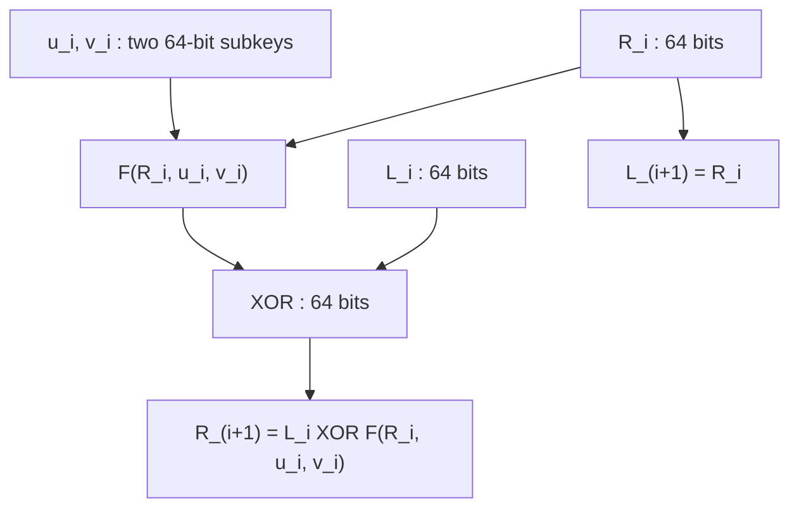
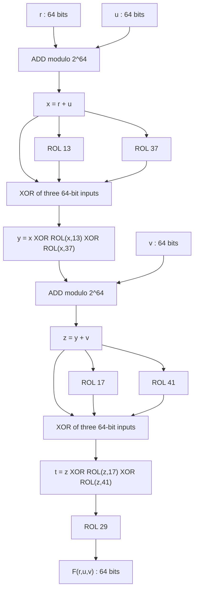
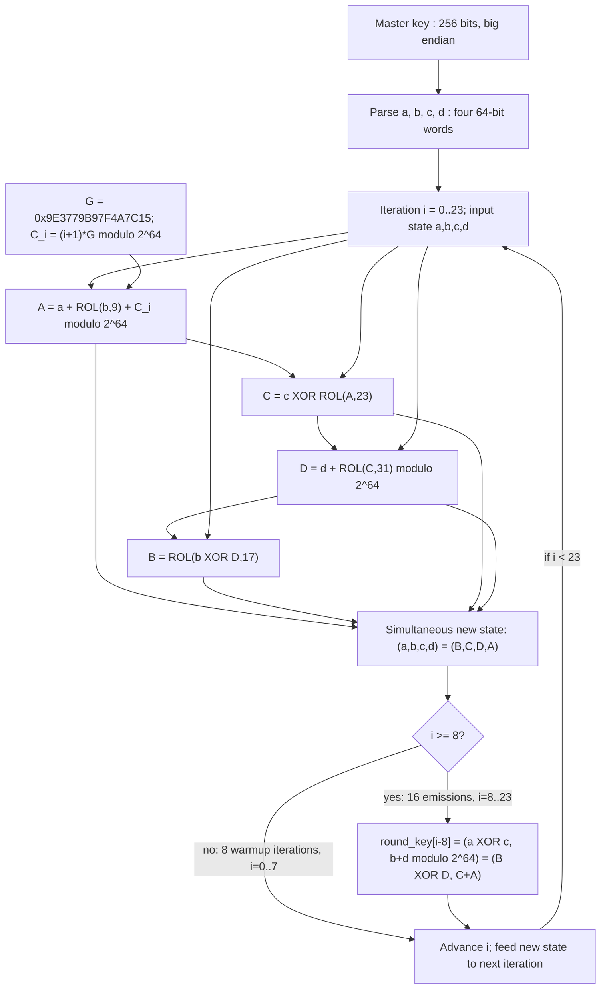

# Cairn v0.1 schematics

Transcribed from the frozen [specification](SPEC.md) and
[`core.py`](../cairn/core.py). Every wire below carries **64 bits**, except the
256-bit master-key input and 128-bit block concatenations. `+` means addition
modulo 2^64; `XOR` is bitwise; `ROL n` rotates a 64-bit word left. Bit 0 is the
least significant bit. These are structural diagrams, not security arguments.

## One complete Feistel round

Parse `BE64(L_0) || BE64(R_0)`. Repeat for `i = 0..15`, then return
`BE64(L_16) || BE64(R_16)`: **no extra final swap and no whitening**.
Both output assignments use the old halves. Reduced variants use the prefix
of the same full schedule. Inverse round:
`(L_i,R_i) = (R_(i+1) XOR F(L_(i+1),u_i,v_i), L_(i+1))`.

## Round function, in implementation order

The three branches of each XOR layer use the **same pre-layer word**; these
are not three sequential in-place XOR updates. Define `P = I XOR ROL13 XOR
ROL37` and `Q = I XOR ROL17 XOR ROL41`. Then `F = ROL29 o Q o A_v o P o A_u`,
where `A_k(x) = x + k (mod 2^64)`.

## Key schedule: one iteration, repeated 24 times

Capital letters below name intermediates, so the sequential dependencies and
final simultaneous reassignment are explicit.

The emission uses the state **after** reassignment. All 24 iterations run even
when an experiment requests fewer than 16 rounds. Each emitted key is 128 bits;
the schedule state remains 256 bits. Constants are public, iteration-dependent
64-bit words, not additional key material.

## Source cross-check

| Diagram | Frozen implementation | Checks |
| --- | --- | --- |
| Feistel | `Cipher.encrypt_block` | Big-endian halves; one swap per round; XOR into old left; no final swap |
| Function | `round_function` | Add u, P, add v, Q, ROL29; all operations on 64 bits |
| Schedule | `expand_key` | ROL9/23/31/17; updated A/C/D dependencies; permute before emission; 8 warmups + 16 keys |

The research reproductions also check an independently written schedule step
and its inverse against all 16 emitted keys, and check both linear-layer
inverses on every basis vector. Frozen-byte conformance remains enforced by
`python -m unittest discover -v`.
